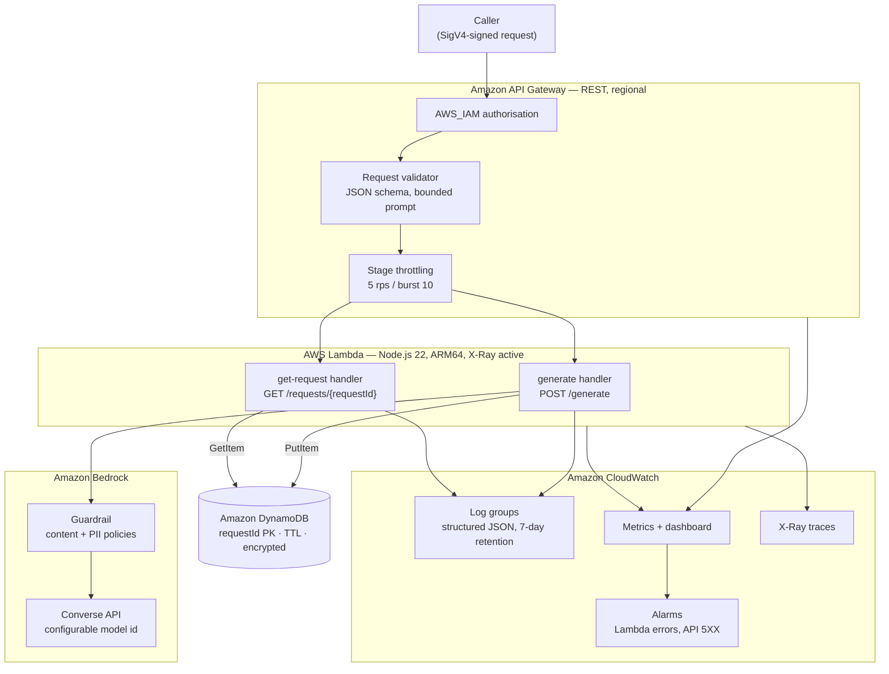

# Serverless GenAI Request Service

A small, complete AWS serverless generative AI application built with the AWS CDK in
TypeScript. It accepts a text prompt over an IAM-authorised API, invokes Amazon Bedrock,
records non-sensitive request metadata in DynamoDB, and exposes the result for later
retrieval — with least-privilege IAM, input validation, AI safety controls, structured
observability, automated tests, CI, and a systematic AI evaluation suite.

Built as professional-learning evidence for **UTS 43030 Professional Practice in
Computing, Assessment 3**, against the learning goal:

> Build and evaluate a secure AWS serverless generative AI application.

---

## 1. Project purpose

The goal is not a commercial product. It is a deliberately small system that is
nevertheless *complete*: every layer a real serverless AI service needs is present and
working, at a scale that can be read end to end, deployed reproducibly, and torn down
for a few cents.

Two endpoints do the work:

| Method | Route | Purpose |
| --- | --- | --- |
| `POST` | `/generate` | Validate a prompt, invoke Bedrock, persist metadata, return the generated text |
| `GET` | `/requests/{requestId}` | Return a previously stored request record |

## 2. Learning objectives

| Capability | Where it is demonstrated |
| --- | --- |
| AWS Lambda | `src/handlers/` — two handlers, Node.js 22, ARM64 |
| Amazon API Gateway | `lib/serverless-genai-stack.ts` — REST API, IAM auth, request validation, throttling, access logs |
| Amazon DynamoDB | On-demand table with TTL and encryption at rest; `src/shared/repository.ts` |
| AWS CDK (TypeScript) | `bin/app.ts`, `lib/` — 100% of infrastructure |
| Amazon Bedrock | `src/shared/bedrock.ts` — Converse API with a configurable model |
| Infrastructure as Code | No console-created resources; `cdk synth` runs in CI |
| Least-privilege IAM | One DynamoDB action per function; Bedrock scoped to one model ARN |
| Input validation & AI safety | `src/shared/validation.ts`, Bedrock guardrail, pinned system prompt |
| CloudWatch logging/metrics/tracing | Structured JSON logs, X-Ray, alarms, dashboard |
| Automated testing | 155 Jest tests including CDK template assertions |
| CI/CD | `.github/workflows/validate.yml` (automatic), `deploy.yml` (manual, OIDC) |
| Structured AI evaluation | `evaluation/` — 13 scored cases across 5 dimensions |
| Architecture documentation | `docs/architecture.md` and this README |
| Reproducible deployment | Pinned lock file, context-driven config, documented single-command deploy |

## 3. Architecture



Request flow for `POST /generate`:

1. API Gateway rejects unsigned requests (`AWS_IAM`) and bodies that fail the JSON schema.
2. The Lambda re-validates the payload (size, type, length, control characters) and
   annotates the prompt with safety flags.
3. Bedrock is invoked through the Converse API with a pinned system prompt, a low
   temperature and a small `maxTokens`, optionally filtered by a guardrail.
4. A metadata record — never the raw prompt — is written to DynamoDB with a TTL.
5. The handler returns `requestId`, the generated text, the model id, a timestamp and
   latency/token metadata, and emits one structured log line per lifecycle event.

See `docs/architecture.md` for component-by-component decisions and trade-offs.

## 4. AWS services used

| Service | Role | Billing shape |
| --- | --- | --- |
| API Gateway (REST) | Authenticated, validated, throttled entry point | Per request |
| Lambda | Application compute (2 functions) | Per ms, ARM64 |
| Bedrock | Text generation + guardrail evaluation | Per token / per text unit |
| DynamoDB | Request record store | On-demand per request |
| CloudWatch Logs/Metrics/Alarms/Dashboard | Observability | Per GB ingested, free-tier alarms/dashboard |
| X-Ray | Distributed tracing | Per trace, generous free tier |
| SNS | Alarm destination (no subscription by default) | Free while unused |
| IAM | Execution roles, authorisation | Free |

Nothing in the stack bills while idle. There is no VPC, NAT gateway, EC2, RDS, EKS,
OpenSearch or provisioned capacity anywhere in the project.

## 5. Security decisions

Summary — full reasoning, including honest limitations, is in `docs/security.md`.

| Control | Implementation |
| --- | --- |
| Authentication | `AuthorizationType.IAM` on both methods: callers must present SigV4 credentials |
| Authorisation (least privilege) | `dynamodb:PutItem` for the generate function, `dynamodb:GetItem` for the retrieval function; no wildcards |
| Bedrock permissions | `bedrock:InvokeModel` scoped to the configured model and inference-profile ARNs only |
| Guardrail permissions | `bedrock:ApplyGuardrail` scoped to the provisioned guardrail ARN |
| Request size limits | API Gateway JSON schema (`maxLength`) plus an 8 KiB body ceiling in the handler |
| Input validation | Type, emptiness, min/max length, control characters, UUID format for path parameters |
| Secrets | None. All configuration is non-sensitive and injected as environment variables by CDK |
| Safe error responses | A fixed error taxonomy; client messages never contain AWS errors, ARNs, table names or stack traces |
| Log sanitisation | Prompt and response text are structurally un-loggable; a deny-list redacts them even if a caller passes them |
| Encryption at rest | DynamoDB SSE with the AWS managed key |
| Encryption in transit | TLS-only API Gateway endpoint; `enforceSSL` on the SNS topic |
| Throttling | Stage-level 5 rps / burst 10 |
| Data minimisation | The raw prompt is never persisted — only its length and a SHA-256 fingerprint |

**This is not production-grade end-user authentication.** IAM authorisation proves an AWS
principal made the call; it has no concept of application users, sessions, consent or
per-user rate limits. That gap is stated plainly in `docs/security.md`.

## 6. Repository structure

```
.
├── bin/app.ts                      CDK application entry point
├── lib/
│   ├── serverless-genai-stack.ts   All infrastructure
│   ├── stack-config.ts             CDK-context-driven settings with defaults
│   └── bedrock-permissions.ts      Model id -> least-privilege ARN resolution
├── src/
│   ├── handlers/
│   │   ├── generate.ts             POST /generate
│   │   └── get-request.ts          GET /requests/{requestId}
│   └── shared/
│       ├── bedrock.ts              Converse client, system prompt, mock client
│       ├── config.ts               Runtime configuration loading
│       ├── errors.ts               Error taxonomy and safe client messages
│       ├── http.ts                 Response construction
│       ├── logger.ts               Structured JSON logger with redaction
│       ├── repository.ts           DynamoDB access
│       └── validation.ts           Validation and safety heuristics
├── test/                           155 Jest tests (unit + CDK assertions)
├── evaluation/
│   ├── cases.json                  13 scored evaluation cases
│   ├── scorer.ts                   Deterministic per-dimension scoring
│   ├── transports.ts               Mock (in-process) and live (SigV4) transports
│   └── run-evaluation.ts           Runner and report generator
├── docs/
│   ├── architecture.md             Design decisions and trade-offs
│   ├── security.md                 Threat model, controls, limitations
│   ├── evaluation.md               Evaluation method and sample report
│   ├── evidence-guide.md           What to capture for the UTS portfolio
│   └── professional-reflection.md  Professional learning reflection
├── .github/workflows/
│   ├── validate.yml                Lint, type-check, test, synth, mock evaluation
│   └── deploy.yml                  Manual deployment via GitHub OIDC
└── cdk.json                        CDK context: model id, limits, retention, toggles
```

## 7. Local development

Requirements: Node.js 20 or newer (CI uses 22), npm, and the AWS CLI if you intend to
deploy.

```bash
npm ci          # install exactly what the lock file pins
npm run lint
npm run typecheck
npm test
npx cdk synth   # requires no AWS credentials
```

`npm run verify` runs all four in sequence.

Every tunable value lives in `cdk.json` context and can be overridden per command:

```bash
npx cdk synth -c environmentName=staging -c bedrockModelId=amazon.nova-lite-v1:0
```

| Context key | Default | Meaning |
| --- | --- | --- |
| `projectName` | `43030-ServerlessGenAI` | Tag and resource-name prefix |
| `environmentName` | `dev` | API stage name and stack suffix |
| `bedrockModelId` | `apac.amazon.nova-micro-v1:0` | Model or inference profile to invoke |
| `bedrockMaxOutputTokens` | `400` | Conservative generation ceiling |
| `bedrockTemperature` | `0.2` | Low variability for reproducible evaluation |
| `maxPromptLength` | `2000` | Maximum accepted prompt characters |
| `recordTtlDays` | `7` | DynamoDB record lifetime |
| `enableGuardrail` | `true` | Provision and apply a Bedrock guardrail |
| `logRetentionDays` | `7` | CloudWatch Logs retention |
| `apiThrottleRateLimit` / `apiThrottleBurstLimit` | `5` / `10` | Stage throttling |
| `mockBedrock` | `false` | Deploy with a deterministic stub instead of calling Bedrock |

## 8. Testing

```bash
npm test                # 155 tests across 8 suites
npm run test:coverage   # with a coverage report in coverage/
```

What is covered:

- **Validation** — valid prompts, empty and whitespace prompts, missing and non-string
  fields, under/over length, control characters, malformed JSON, oversized bodies,
  UUID path-parameter validation including traversal-style input.
- **Bedrock client** — success and usage metadata, the exact Converse request shape,
  guardrail attachment, guardrail interventions, empty completions, and the distinction
  between configuration faults (`AccessDeniedException`) and transient faults
  (`ThrottlingException`) — asserting that neither leaks into the client response.
- **DynamoDB repository** — item shape, TTL computation, the idempotency condition, the
  absence of raw prompt text, and safe error wrapping for both reads and writes.
- **Handlers** — the full success path, persisted record contents, safety-flag recording,
  structured-log assertions (including that the prompt never appears in any log line),
  every rejection code, Bedrock failure, guardrail block, persistence failure, failed
  failure-bookkeeping, and a generic 500 that leaks no configuration detail.
- **Retrieval** — stored record, not found, failure records, invalid ids, and that
  internal attributes (`ttl`, `promptFingerprint`) are never returned.
- **Infrastructure** — CDK template assertions for billing mode, key schema, encryption,
  TTL, runtime, tracing, timeouts, IAM action-by-action least privilege, IAM wildcard
  absence, IAM in mock mode, API authorisation type, routes, request validation schema,
  throttling, tracing and access logging, guardrail policies, guardrail disablement, log
  retention, alarms, dashboard, tags, outputs, and the absence of every expensive
  resource type.
- **Evaluation harness** — suite well-formedness and the scorer's own pass/fail/skip logic.

No test makes a live AWS call; the AWS SDK is stubbed with `aws-sdk-client-mock`.

## 9. CDK deployment

```bash
# 1. Confirm identity and region
aws sts get-caller-identity
aws configure get region

# 2. One-time per account/region
npx cdk bootstrap

# 3. Review and deploy
npx cdk diff
npx cdk deploy --outputs-file cdk-outputs.json
```

The stack name is `ServerlessGenAi-<environmentName>` (default `ServerlessGenAi-dev`).
Outputs include `ApiBaseUrl`, `GenerateEndpoint`, `RequestTableName`,
`GenerateFunctionName`, `BedrockModelId`, `BedrockMode` and `GuardrailEnabled`.

Deployment requires permissions to create the resources listed in section 4, plus
`bedrock:CreateGuardrail` if `enableGuardrail` is true. If your account cannot create
guardrails, deploy with `-c enableGuardrail=false`; application-level validation is
unaffected.

## 10. API usage

Both methods require SigV4 signing. The calling principal needs
`execute-api:Invoke` on the method ARN.

With `curl` (7.75 or newer):

```bash
API=$(aws cloudformation describe-stacks --stack-name ServerlessGenAi-dev \
  --query "Stacks[0].Outputs[?OutputKey=='ApiBaseUrl'].OutputValue" --output text)
REGION=$(aws configure get region)

curl -sS "${API}generate" \
  --aws-sigv4 "aws:amz:${REGION}:execute-api" \
  --user "$AWS_ACCESS_KEY_ID:$AWS_SECRET_ACCESS_KEY" \
  -H "x-amz-security-token: $AWS_SESSION_TOKEN" \
  -H 'content-type: application/json' \
  -d '{"prompt":"Explain serverless computing in one paragraph."}'
```

Request:

```json
{ "prompt": "Explain serverless computing in one paragraph." }
```

Response (`200`):

```json
{
  "requestId": "3f1a9c2e-6b7d-4e3a-9f21-8c5d4b2a1e07",
  "response": "Serverless computing lets you run code without provisioning servers...",
  "modelId": "apac.amazon.nova-micro-v1:0",
  "createdAt": "2026-10-08T01:02:03.000Z",
  "metadata": {
    "latencyMs": 812,
    "stopReason": "end_turn",
    "inputTokens": 14,
    "outputTokens": 96,
    "safetyFlags": [],
    "mode": "live"
  }
}
```

Retrieval:

```bash
curl -sS "${API}requests/3f1a9c2e-6b7d-4e3a-9f21-8c5d4b2a1e07" \
  --aws-sigv4 "aws:amz:${REGION}:execute-api" \
  --user "$AWS_ACCESS_KEY_ID:$AWS_SECRET_ACCESS_KEY" \
  -H "x-amz-security-token: $AWS_SESSION_TOKEN"
```

Error responses carry a stable machine-readable code and a message that is safe to show
a caller:

```json
{ "error": { "code": "PROMPT_TOO_LONG", "message": "Field \"prompt\" must not exceed 2000 characters." },
  "requestId": "3f1a9c2e-6b7d-4e3a-9f21-8c5d4b2a1e07" }
```

| Status | Codes |
| --- | --- |
| `400` | `EMPTY_BODY`, `MALFORMED_JSON`, `BODY_TOO_LARGE`, `INVALID_PAYLOAD`, `MISSING_PROMPT`, `INVALID_PROMPT_TYPE`, `EMPTY_PROMPT`, `PROMPT_TOO_SHORT`, `PROMPT_TOO_LONG`, `INVALID_CHARACTERS`, `MISSING_REQUEST_ID`, `INVALID_REQUEST_ID` |
| `403` | API Gateway rejection — missing or invalid SigV4 signature |
| `404` | `NOT_FOUND` |
| `422` | `CONTENT_BLOCKED` (guardrail intervention) |
| `429` | API Gateway rejection — stage throttle exceeded |
| `502` | `MODEL_UNAVAILABLE` |
| `503` | `PERSISTENCE_FAILURE` |
| `500` | `INTERNAL_ERROR` |

## 11. Bedrock configuration

The model is **configuration, not code**. `src/shared/bedrock.ts` reads
`BEDROCK_MODEL_ID` from the environment, which CDK sets from the `bedrockModelId`
context value. Because the Converse API presents one request/response shape across model
families, changing the model requires no code change.

```bash
# Confirm what the account can actually invoke in this region
aws bedrock list-foundation-models \
  --query 'modelSummaries[?outputModalities[0]==`TEXT`].[modelId,modelName]' --output table
aws bedrock list-inference-profiles --query 'inferenceProfileSummaries[].inferenceProfileId' --output table

# Deploy with a different model
npx cdk deploy -c bedrockModelId=apac.amazon.nova-lite-v1:0
```

The default, `apac.amazon.nova-micro-v1:0`, is an Asia-Pacific cross-region inference
profile for Amazon Nova Micro — the cheapest text model available in `ap-southeast-2` at
the time of writing. `lib/bedrock-permissions.ts` detects whether the configured id is an
inference profile (three dot-separated segments) or a plain foundation model (two) and
grants only the ARNs that addressing style requires.

Generation limits are deliberately conservative: `maxTokens` 400 and `temperature` 0.2,
which bounds cost per call and keeps evaluation runs comparable.

**If Bedrock model access is unavailable** in your account or region, deploy with
`-c mockBedrock=true`. The Lambda then returns deterministic text prefixed `[mock-mode]`,
`metadata.mode` reports `mock`, no Bedrock IAM permissions are granted at all, and every
other layer — validation, persistence, retrieval, logging, metrics, tracing — behaves
identically. Mock output is always labelled as such and must never be presented as live
model evidence.

## 12. Observability

**Structured logging.** One JSON object per line, queryable directly in CloudWatch Logs
Insights:

```json
{"level":"INFO","message":"request completed","timestamp":"2026-10-08T01:02:03.456Z",
 "service":"serverless-genai","operation":"generate","environment":"dev",
 "requestId":"3f1a9c2e-...","correlationId":"<API Gateway request id>",
 "modelId":"apac.amazon.nova-micro-v1:0","status":"succeeded","durationMs":812,
 "modelLatencyMs":690,"inputTokens":14,"outputTokens":96,"stopReason":"end_turn",
 "responseLength":512}
```

Every line carries the service, operation, environment, application `requestId` and the
API Gateway `correlationId`, so a single request can be followed across both. Failure
lines add `errorCategory`, `errorCode` and `statusCode`. Prompt and response text are
redacted structurally — `prompt`, `response`, `token`, `secret` and similar field names
are on a deny-list in the logger itself, so even a careless call site cannot leak them.

Useful queries:

```
fields @timestamp, operation, status, errorCode, durationMs
| filter service = "serverless-genai" and status = "failed"
| sort @timestamp desc

stats count() by errorCategory, errorCode
```

**Metrics.** API Gateway stage metrics are enabled (`Count`, `4XXError`, `5XXError`,
`Latency`), alongside standard Lambda and DynamoDB metrics. A CloudWatch dashboard named
`<projectName>-<environmentName>` charts API traffic and errors, API latency percentiles,
Lambda invocations/errors, generate-handler duration percentiles, and DynamoDB consumed
capacity.

**Alarms.** Two, both with `TreatMissingData: notBreaching` and an SNS topic as the
action (no subscription is created — add your own email subscription to receive
notifications):

- generate Lambda `Errors` > 0 over 5 minutes
- API Gateway `5XXError` > 0 over 5 minutes

**Tracing.** X-Ray active tracing on both Lambda functions and the API Gateway stage,
giving end-to-end API→Lambda traces. Note the honest limitation: AWS SDK calls inside the
handler are not instrumented as subsegments, so Bedrock and DynamoDB timings appear in
the structured logs (`modelLatencyMs`, `durationMs`) rather than as separate trace
segments. Adding the X-Ray SDK would close that gap and is listed as an extension in
`docs/architecture.md`.

**Log retention** is 7 days on all three log groups (two Lambda, one API access log), so
log storage cost stays near zero.

## 13. AI evaluation

Trying one prompt by hand is not evaluation. `evaluation/` contains a 13-case suite
scored across five dimensions — outcome, relevance, format compliance, safety behaviour
and latency — covering factual explanation, summarisation, structured output, an ordinary
developer question, empty/whitespace/oversized input, malformed JSON, two prompt-injection
styles, a sensitive-data request, a persistence round trip, and not-found behaviour.

```bash
npm run evaluate:mock                                  # no AWS account needed
npm run evaluate -- --mode live --api "$API_BASE_URL"  # against the deployed API
```

Both modes write `evidence/evaluation-<mode>.json` and `evidence/evaluation-<mode>.md`.

The two modes are not interchangeable and the harness says so in its own output:

- **Mock mode** runs the real handler code in-process with the AWS SDK clients stubbed.
  It verifies routing, validation, safety flagging, persistence and error handling.
  Because the model output is canned, the relevance, format and latency dimensions are
  reported as **skipped** — never as passed.
- **Live mode** sends SigV4-signed HTTPS requests to the deployed API and is the only
  mode whose results may be presented as live Bedrock evidence.

See `docs/evaluation.md` for the method, the dimension definitions, the committed sample
report, and what the current results do and do not establish.

## 14. CI/CD

**`validate.yml`** runs on every push to `main` or `feature/**`, on pull requests, and on
demand: `npm ci`, lint, type-check, the full test suite, `cdk synth` with placeholder
account/region values, and the mock evaluation suite — whose report is uploaded as a
build artifact. It needs no AWS credentials.

**`deploy.yml`** is `workflow_dispatch` only, and additionally requires the dispatcher to
type `deploy` into a confirmation input. Deployment on every commit would make both cost
and model behaviour unpredictable, which is the opposite of what this project is meant to
demonstrate.

Deployment authenticates with **GitHub OIDC**, not long-lived access keys. Required
setup, with the IAM trust policy, is in `docs/security.md`. In short: create an IAM role
trusting `token.actions.githubusercontent.com` scoped to this repository, then set the
repository variable `AWS_DEPLOY_ROLE_ARN`. No AWS secret is stored in the repository.

`.github/dependabot.yml` groups npm and GitHub Actions updates weekly/monthly.

## 15. Cost controls

| Control | Effect |
| --- | --- |
| Everything serverless and on-demand | Idle cost is effectively zero |
| No EC2, NAT gateway, RDS, EKS, OpenSearch, ALB, or provisioned capacity | Asserted by a test that fails if any appear |
| `maxTokens` 400, `temperature` 0.2 | Bounds Bedrock cost and variance per call |
| `maxPromptLength` 2000 + 8 KiB body ceiling | Bounds input tokens; limits denial-of-wallet exposure |
| Stage throttling 5 rps / burst 10 | Caps request volume |
| DynamoDB on-demand + 7-day TTL | Pay per request; records self-delete |
| Point-in-time recovery disabled | Avoids continuous-backup charges on disposable data |
| 7-day log retention, `dataTraceEnabled: false` | Minimises log ingestion and storage |
| AWS managed KMS key for DynamoDB | No monthly key charge |
| ARM64 Lambda, 512/256 MB | Lower per-ms price |
| One dashboard, two alarms | Within the CloudWatch free tier |
| Mock mode available | Full exercise of the system with zero Bedrock spend |

Realistic exposure for portfolio use: deploy, make a handful of calls, screenshot, destroy
— cents, not dollars. A few hundred Nova Micro calls at these limits remain well under a
dollar. The dominant residual cost if the stack is left deployed is CloudWatch log
storage, which the 7-day retention bounds.

## 16. Cleanup

```bash
npx cdk destroy
```

Everything is removable: the DynamoDB table, all three log groups and the guardrail carry
`RemovalPolicy.DESTROY`, so no orphaned resources remain and the table's demo data is
deleted with it.

One account-level side effect to be aware of: enabling API Gateway stage logging requires
an account-wide API Gateway CloudWatch Logs role, which this stack creates and sets. It
carries `RemovalPolicy.DESTROY`. If you deploy into a **shared** account that already has
that setting configured, read `docs/security.md` first — the deployment will overwrite it.

Verify afterwards:

```bash
aws cloudformation describe-stacks --stack-name ServerlessGenAi-dev   # should not exist
aws dynamodb list-tables
```

## 17. Limitations

Stated plainly, because an evidence repository that oversells itself is worse than one
that does less:

1. **IAM authorisation is not end-user authentication.** It authenticates an AWS
   principal, not an application user. No users, sessions, consent, or per-user quotas.
2. **Prompt-injection defences are mitigations, not boundaries.** A pinned system prompt,
   regex heuristics and a Bedrock guardrail reduce risk; none is a security boundary, and
   the heuristics are trivially bypassed by rephrasing. The injection cases in the
   evaluation suite check *observable behaviour*, not immunity.
3. **Single region, single stage, no multi-environment pipeline.** The code is
   environment-neutral and `environmentName` is a context value, but only one stage has
   been exercised.
4. **No load, soak or chaos testing.** Latency figures come from a handful of calls, not
   a distribution.
5. **Tracing is coarse.** API→Lambda traces exist; AWS SDK subsegments do not.
6. **Evaluation is deterministic string and status scoring**, not model-graded or
   human-rated quality assessment. It proves the method, at a scale appropriate to the
   assessment.
7. **No response caching, idempotency key, or retry queue.** A repeated identical prompt
   costs a fresh Bedrock call.
8. **`npm audit` reports advisories in build tooling** (transitive `brace-expansion` and
   `sprintf-js` DoS advisories reached through Jest, ESLint and the bundled CDK CLI). The
   runtime dependency tree is clean; see `docs/security.md`.
9. **Deployment verification status** is recorded in `docs/evaluation.md`. Anything not
   verified against live AWS is labelled as such there rather than implied here.

## 18. Professional learning reflection

I came into this project already working with AWS, TypeScript and Python, Docker, CI/CD,
APIs, authentication, production reliability, Amazon Bedrock and software testing. The
learning was therefore not "how AWS works" — it was integration: turning capabilities I
had used separately into one reproducible, reviewable architecture where the security
model, the observability model, the test strategy and the AI evaluation all have to agree
with each other.

The parts that genuinely changed how I work: expressing least privilege as code precise
enough to assert in a test; discovering that a cross-region inference profile needs a
different ARN shape than a foundation model, and that getting that wrong is invisible
until deployment; treating log-field redaction as a type-level concern rather than a
review checklist item; and building an evaluation harness that reports "skipped" instead
of quietly passing dimensions it cannot judge — which turned out to be the most important
honesty mechanism in the project.

The full reflection is in `docs/professional-reflection.md`.

---

## Documentation index

| Document | Contents |
| --- | --- |
| `docs/architecture.md` | Component decisions, trade-offs, rejected alternatives, extensions |
| `docs/security.md` | Threat model, control-by-control detail, OIDC setup, limitations |
| `docs/evaluation.md` | Evaluation method, dimensions, sample report, verification status |
| `docs/evidence-guide.md` | E1–E15: exactly what to capture for the UTS portfolio |
| `docs/professional-reflection.md` | Professional learning reflection |
